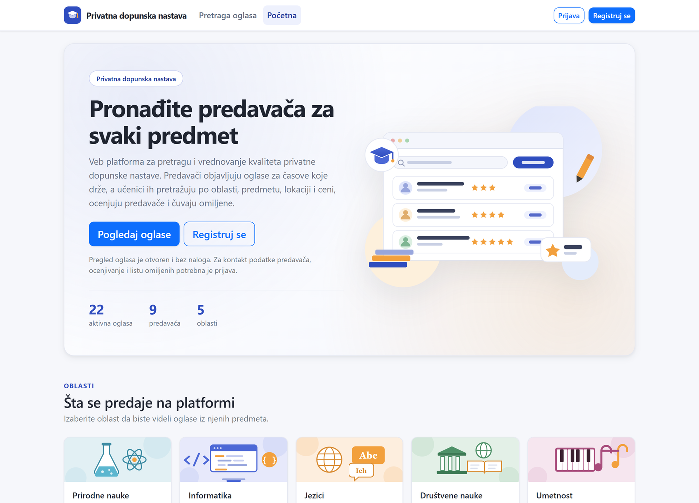
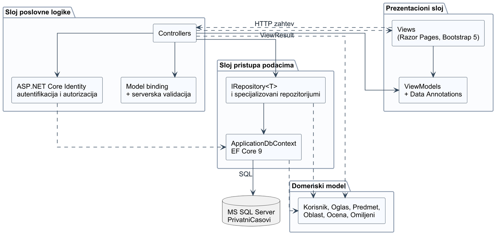
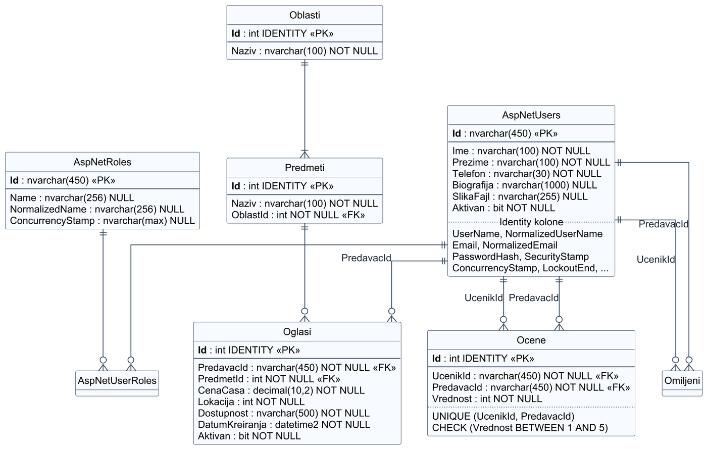
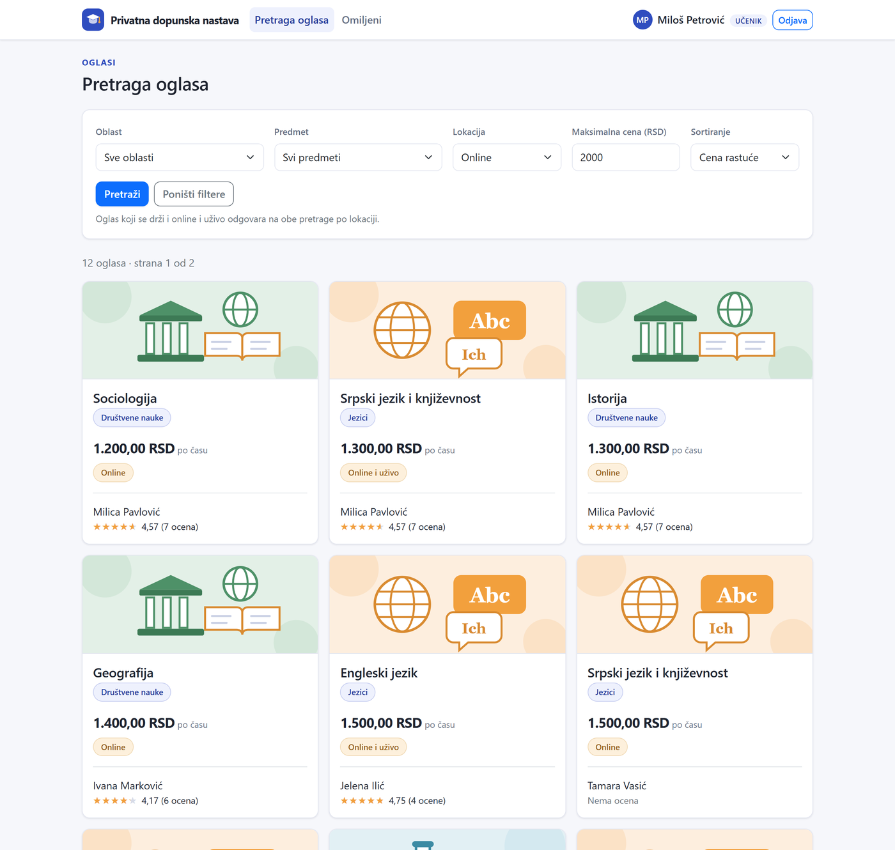
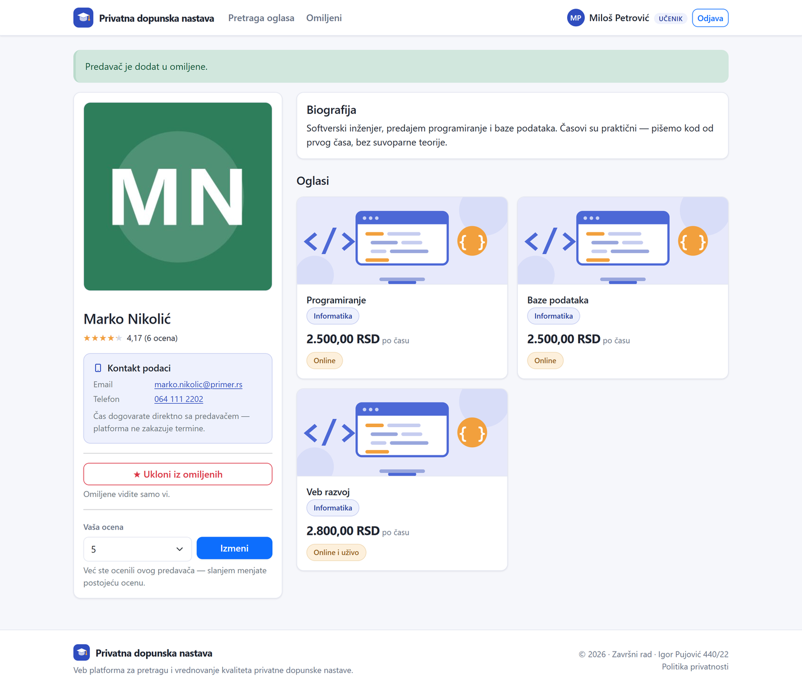
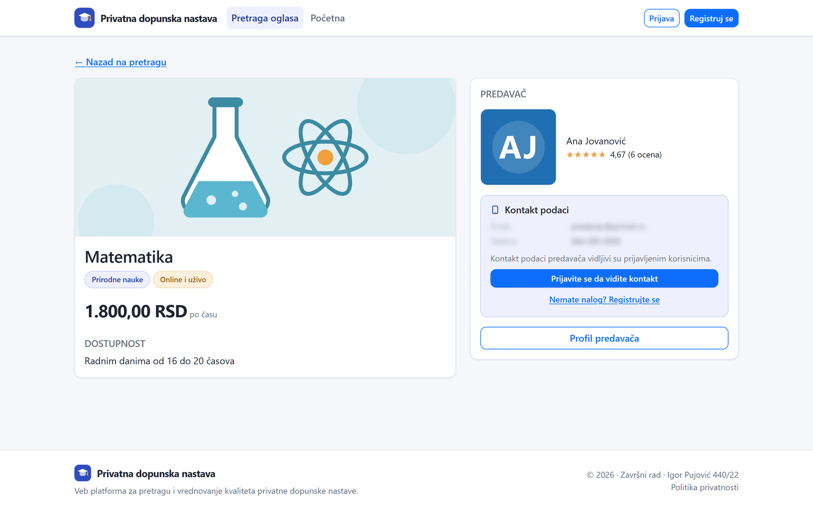
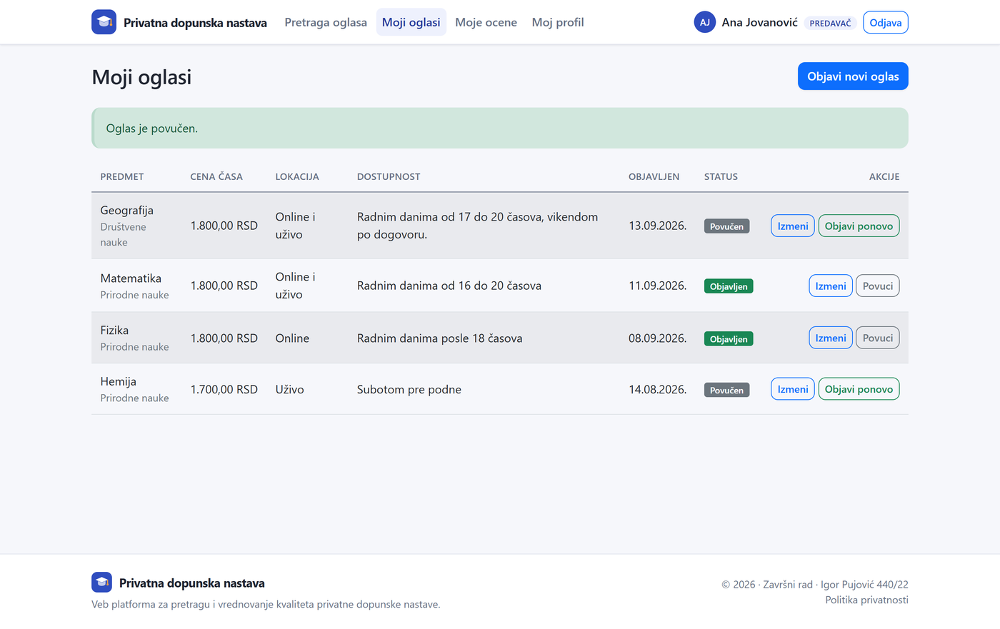
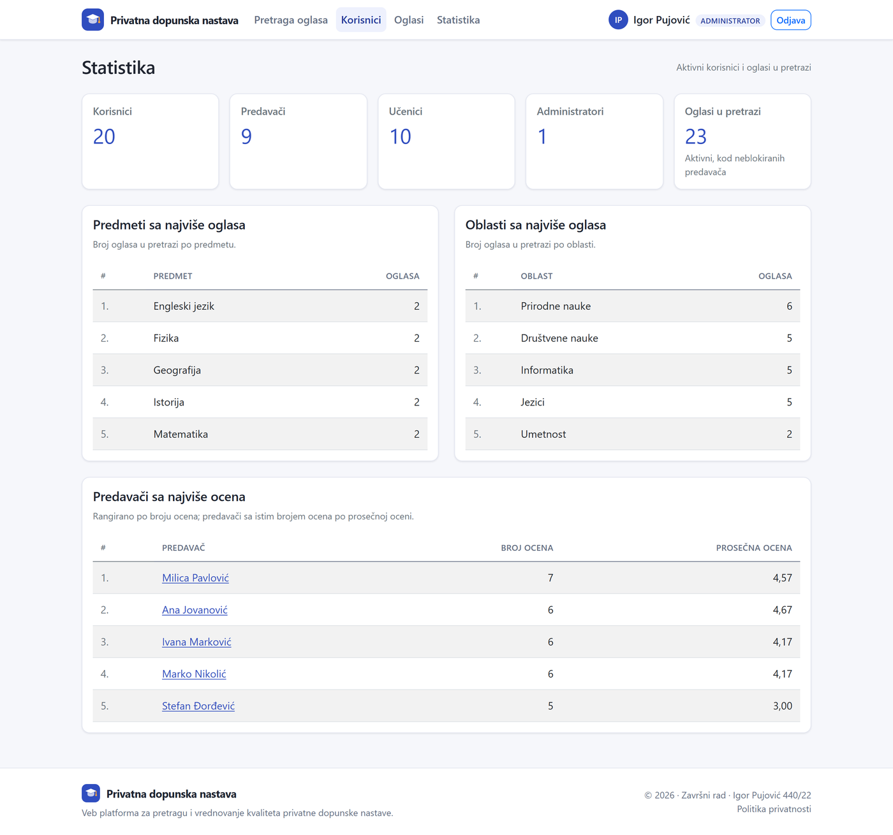

# Private Tutoring Platform

A web platform where tutors post listings for private lessons and students search them, rate tutors and keep a list of favorites. An administrator manages accounts, listings and platform statistics.

Built as my final (bachelor's) thesis at the College of Applied Studies for Information Technology (ITS), Belgrade, 2026. The user interface is in Serbian.



## Tech stack

| Area | Technology |
| --- | --- |
| Platform | .NET 8 |
| Web framework | ASP.NET Core MVC, Razor views |
| Data access | Entity Framework Core 9, Repository pattern |
| Database | Microsoft SQL Server (LocalDB / Express) |
| Authentication | ASP.NET Core Identity, role-based authorization |
| UI | Bootstrap 5 (responsive) |
| Testing | Playwright (Python), 26 automated end-to-end scenarios |

## Features

**Visitors (not logged in)**
- Browse the home page, search, listings and tutor profiles
- Tutor contact details are hidden until login (not just visually: they are not in the HTML response at all)

**Students**
- Search listings by field, subject, lesson type (online / in person) and maximum price
- Sort by price, average rating, number of ratings or date, with pagination
- Rate tutors from 1 to 5 and change their rating later
- Keep a private list of favorite tutors

**Tutors**
- Create, edit, withdraw and republish their own listings (one subject per listing, with price, lesson type and availability)
- See the ratings they received and their average, without the identity of the students who gave them
- Edit profile details, bio and photo

**Administrator**
- View all accounts and listings, including inactive ones
- Block and unblock accounts, deactivate and reactivate listings
- Platform statistics: users per role, active listings, top subjects, fields and tutors

## Architecture

The app follows a layered architecture with the MVC pattern. Controllers never query the database directly; they depend only on repository interfaces, which are wired up through dependency injection.



Key design decisions:

- **Visibility rule in one place.** The repository has a single method that returns only active listings from active tutors. Every public screen (search, profiles, statistics) goes through it, so blocking a tutor hides all their listings without touching the listings themselves.
- **Nothing is deleted.** Blocking users and withdrawing listings are status changes, so ratings and averages stay consistent. The only real delete is removing a tutor from favorites.
- **Average rating is calculated, not stored.** It is computed in the same SQL query as the search results, so it can never be out of date. Tutors without ratings show "no ratings" and sort after rated tutors.
- **Anonymous ratings by design.** The model has no navigation path from a tutor to the students who rated them.
- **Secure by default.** A fallback authorization policy requires login unless an action is explicitly public, all state-changing forms use anti-forgery tokens, and ownership is checked on every write.
- **Blocked users are logged out.** Blocking updates the security stamp, so existing sessions stop being valid.

### Database



Some rules are enforced in the database as well, not only in the application:

- Unique index on `Ocene (UcenikId, PredavacId)`: one rating per student per tutor, even with simultaneous requests
- `CHECK` constraint: rating value (`Ocene.Vrednost`) between 1 and 5
- Composite primary key on `Omiljeni` (favorites)
- No cascade delete on any foreign key
- `decimal(10,2)` for lesson prices (`Oglasi.CenaCasa`)

## Screenshots

| Search with filters | Tutor profile |
| --- | --- |
|  |  |

| Contact hidden from visitors | Tutor's listings |
| --- | --- |
|  |  |

| Admin statistics |
| --- |
|  |

## Getting started

**Requirements:** .NET 8 SDK, SQL Server 2016 or newer (Express, Developer or LocalDB), Visual Studio 2022 or VS Code.

1. Clone the repository:
   ```
   git clone https://github.com/igorpujovic/privatni-casovi.git
   ```
2. If needed, change `Server=` in the connection string in `appsettings.json` (default is `(localdb)\mssqllocaldb`).
3. Run the app:
   ```
   dotnet run --project "Privatni casovi"
   ```
   Or open `Privatni casovi.slnx` in Visual Studio and press Ctrl+F5.

On first start the app applies migrations and fills an empty database with demo data: 5 fields, 15 subjects, 21 users, 25 listings and 40 ratings.

Alternatively, create the database manually with the SQL script:
```
sqlcmd -S <server> -i docs/predaja/privatni-casovi.sql
```

### Demo accounts

All demo accounts use the password `lozinka123`.

| Role | Email |
| --- | --- |
| Tutor | ana.jovanovic@primer.rs |
| Student | milos.petrovic@primer.rs |
| Administrator | admin@privatnicasovi.rs |

## Testing

The app was tested with 26 automated end-to-end scenarios written in Python with Playwright. Each scenario drives a real browser through the UI and then checks the database state with SQL queries. The scenarios cover all three roles, visitors, access control, server-side validation and database constraints. **All 26 passed.**

The test script is in `docs/zavrsni-rad/testovi/testovi.py`.

## Possible improvements

- Unit tests for the repository layer
- Moving pagination from memory into the database query
- Lesson scheduling, so only students who attended a lesson can rate a tutor
- Internal messaging between students and tutors

## Author

Igor Pujović · [GitHub](https://github.com/igorpujovic)  
